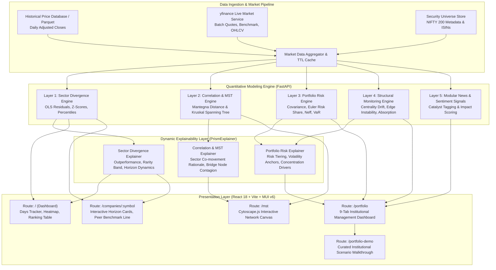
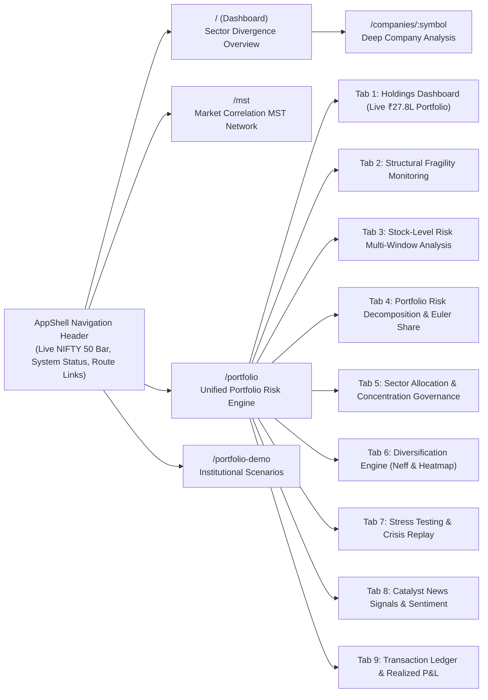

# PRISM: System Architecture, Structural Flow & Feature Specification

> **PRISM** (**P**ortfolio **R**isk & **I**ntelligent **S**tructural **M**onitoring) is an institutional-grade, explainable market intelligence and portfolio risk engine for the Indian equity universe (NIFTY 200). It unifies econophysics network models, econometric sector divergence analytics, multi-factor risk attribution, and condition-responsive real-time natural language explanations into a unified, responsive interface.

---

## 1. Executive Summary & Design Principles

### Core Mission
Traditional portfolio tools provide black-box metrics (e.g., "Beta: 1.12" or "VaR: -2.4%") without context or narrative. PRISM bridges this gap by combining **quantitative rigor** with **dynamic, condition-driven explanations** that explain *why* metrics look the way they do, *how* market regimes are shifting, and *where* systemic vulnerabilities hide.

### Key Architectural Pillars
1. **Explainable Financial Intelligence**: Every quantitative metric (Z-score, Euler risk share, MST edge weight, diversification ratio) is accompanied by real-time explanations that adapt dynamically to changing user parameters, horizons, and market conditions.
2. **Hybrid Point-in-Time & Live Market Pipeline**: Merges clean, adjusted historical price series with live intraday quotes and delta updates via `yfinance`, guaranteeing historical integrity with zero forward-looking bias while providing real-time pricing.
3. **Econophysics Network Modeling**: Utilizes Mantegna log-return correlation distances and Kruskal's Minimum Spanning Tree (MST) algorithm to identify market topology, cluster cohesion, and systemic bridge stocks.
4. **Local-First & Anonymous Execution**: Zero mandatory authentication or server-side portfolio tracking; portfolio calculations execute in-memory with optional local browser caching for complete privacy.
5. **Unified Modern Design System**: Built with an expansive 90vw desktop footprint, Google Fonts (`Inter` + `JetBrains Mono`), and a curated color palette (Deep Navy, Forest Green, Crimson Red, Amber, and Teal).

---

## 2. End-to-End System Architecture Workflow

The following diagram illustrates how raw market data flows through the quant calculation engines, explainability layer, and down to the user interface:



---

## 3. Website Structural Flow & Navigation Hierarchy

The frontend is structured around a centralized layout container ([AppShell.tsx](file:///c:/Users/Pratham/OneDrive/Desktop/Mini%20Project/PRISM/frontend/src/AppShell.tsx)) providing a persistent navigation bar, live market benchmark tracker, data freshness badges, and 90vw viewport optimization.



---

## 4. Comprehensive Feature Breakdown

### Feature 1: Multi-Horizon Sector Divergence Engine
* **Purpose**: Identifies individual stocks diverging significantly from their industry peers to highlight company-specific idiosyncratic alpha vs. broad sector momentum.
* **Mathematical Formulation**:
  1. For each stock $i$ in industry $I$, calculate its return $R_{i,t}$ over horizon $H \in \{1, 5, 20\}$ trading days.
  2. Compute the **leave-one-out peer median return**:
     $$\tilde{R}_{-i,t} = \text{median}\left(\{ R_{j,t} \mid j \in I, j \neq i \}\right)$$
  3. Calculate the **residual return**:
     $$\epsilon_{i,t} = R_{i,t} - \left( \hat{\alpha}_i + \hat{\beta}_i \tilde{R}_{-i,t} \right)$$
  4. Standardize into a rolling statistical **$Z$-score (Divergence Score)**:
     $$Z_{i,t} = \frac{\epsilon_{i,t} - \mu_{\epsilon,i}}{\sigma_{\epsilon,i}}$$
* **Interactive UI Controls on Dashboard**:
  - **Days Tracker Toggle**: Switch between **1-Day** (daily noise & earnings reactions), **5-Day** (weekly tactical repositioning), and **20-Day** (structural medium-term decoupling).
  - **Live Search**: Instant keyword search by ticker symbol or full company name.
  - **Sorting Controls**: Sort by Best to Worst ($+Z \to -Z$), Worst to Best ($-Z \to +Z$), Absolute Magnitude ($|Z|$), or Residual Value.
  - **Industry Filters**: Filter by Auto, Banking, FMCG, IT, Metals, Oil & Gas, Healthcare, etc.
  - **Statistical Rarity Chips**: Color-coded badges for Extreme ($|Z| \ge 2\sigma, p < 0.05$), Strong ($1\sigma \le |Z| < 2\sigma$), and Normal ($|Z| < 1\sigma$).

---

### Feature 2: In-Depth Company Intelligence (`/companies/:symbol`)
* **Purpose**: Provides deep econometric breakdown of a selected company against its peers.
* **Key Components**:
  - **Hero Header**: Real-time stock price, day change, industry classification, beta against peers, and residual volatility.
  - **Interactive Horizon Cards (1D, 5D, 20D)**: Allows users to click between horizons; each card displays the exact divergence value, percentile rank, and residual alpha.
  - **Dynamic Explainer**: Re-evaluates in real time to explain whether outperformance is driven by fundamental earnings beats or sector drag, displaying statistical significance.
  - **Peer Comparison Line Chart**: Normalized indexed time series (indexed to $100$) plotting the stock's return trajectory directly against its leave-one-out peer benchmark.
  - **Peer Constituent Roster**: Table of all peer companies included in the leave-one-out calculation.

---

### Feature 3: Portfolio Holdings Management & Real-Time Net Worth
* **Curated Portfolio Profile**:
  - Initialized with **18 institutional-grade holdings** valued at approximately **₹27.8 Lakhs**.
  - Balanced across 6 industry clusters: Financial Services (HDFC Bank, ICICI Bank, SBI, Axis Bank, Kotak, Bajaj Finance), Technology (TCS, Infosys, HCLTech), Industrials & Capex (Larsen & Toubro, Reliance), Automotive (Tata Motors, Mahindra & Mahindra), Healthcare (Sun Pharma), and Consumer Goods (ITC, Titan, Tata Consumer).
  - Features a realistic mix of profitable compounders and underperforming positions to demonstrate risk hedging.
* **Live Market Enrichment**:
  - Automatically fetches real-time quotes, previous closing prices, and day changes via the backend market data service.
  - Displays Total Invested Capital, Current Market Value, Absolute Unrealized P&L, Unrealized Return %, and Today's Net P&L.
* **Transaction Ledger & Trading Modal**:
  - Interactive **Buy Holding** and **Sell Holding** dialogs.
  - Supports FIFO/average cost basis calculations and maintains a full transaction audit trail with realized capital gains tracking.
  - Export portfolio to CSV or reset to default curated allocation with one click.

---

### Feature 4: Portfolio Risk Decomposition & Euler Risk Attribution
* **Purpose**: Uncovers where risk actually originates, preventing the common mistake of assuming a high-weight stock is automatically the highest risk contributor.
* **Mathematical Formulation (Euler's Theorem)**:
  - Total portfolio variance is $\sigma_p^2 = \mathbf{w}^T \mathbf{\Sigma} \mathbf{w}$.
  - The Marginal Contribution to Risk (MCR) for asset $i$ is:
    $$\text{MCR}_i = \frac{\partial \sigma_p}{\partial w_i} = \frac{(\mathbf{\Sigma} \mathbf{w})_i}{\sigma_p}$$
  - The percentage risk contribution is:
    $$\%RC_i = \frac{w_i \cdot \text{MCR}_i}{\sigma_p} \times 100$$
  - $\sum_{i=1}^N \%RC_i = 100\%$.
* **Risk Amplifier Detection**:
  - Flags any stock where $\%RC_i > w_i$ as an **Amplified Risk Asset** (e.g., highly volatile or strongly correlated assets driving disproportionate portfolio risk).

---

### Feature 5: Diversification Engine & Effective Number of Bets ($N_{\text{eff}}$)
* **Effective Number of Bets ($N_{\text{eff}}$)**:
  - Measures the true degree of diversification based on independent risk factors rather than simply counting stock tickers:
    $$N_{\text{eff}} = \frac{1}{\sum_{i=1}^N (\%RC_i)^2}$$
  - A portfolio with 18 stocks might only have $N_{\text{eff}} = 12.4$ if banking and tech stocks are highly correlated.
* **Diversification Ratio (DR)**:
  $$\text{DR} = \frac{\sum_{i=1}^N w_i \sigma_i}{\sigma_p}$$
  - Quantifies the volatility reduction achieved via diversification. Values $> 1.30$ indicate strong diversification benefits.
* **Pairwise Correlation Heatmap**:
  - Full interactive $N \times N$ matrix displaying cross-asset Pearson correlation coefficients ($\rho_{ij}$).

---

### Feature 6: Minimum Spanning Tree (MST) Correlation Network (`/mst`)
* **Purpose**: Maps the structural topology of the equity universe using econophysics principles to detect systemic connectivity, market clusters, and transmission channels.
* **Mathematical Formulation (Mantegna Distance)**:
  1. Calculate log returns for all active securities: $r_{i,t} = \ln(P_{i,t} / P_{i,t-1})$.
  2. Compute pairwise Pearson correlation matrix $\mathbf{C} = [\rho_{ij}]$.
  3. Transform correlation coefficients into Euclidean distances satisfying metric axioms:
     $$d_{ij} = \sqrt{2 (1 - \rho_{ij})}, \quad \text{where } d_{ij} \in [0, 2]$$
     - Perfect correlation ($\rho = 1.0$) $\to d_{ij} = 0.0$.
     - Uncorrelated ($\rho = 0.0$) $\to d_{ij} = \sqrt{2} \approx 1.414$.
     - Perfectly anti-correlated ($\rho = -1.0$) $\to d_{ij} = 2.0$.
  4. Apply **Kruskal's Algorithm** to construct an acyclic, connected graph spanning all $N$ vertices using exactly $N-1$ edges that minimize total network distance.
* **Interactive Visualization (Cytoscape.js)**:
  - Node size proportional to degree centrality (number of connected edges).
  - Node color grouped by sector classification.
  - Edge thickness inversely proportional to distance (stronger correlations = thicker, more intense lines).
  - Highlights **Bridge Nodes** (such as Larsen & Toubro or Reliance) that act as single points of cross-sector shock propagation.

---

### Feature 7: Structural Fragility & Regime Shift Monitoring
* **Purpose**: Detects systemic market shifts before they manifest in headline drawdowns.
* **Core Indicators**:
  1. **Absorption Ratio (AR)**: Proportion of total market variance explained by the top eigenvectors of the covariance matrix. High AR indicates tight coupling and heightened fragility.
  2. **Network Centrality Drift**: Tracks whether hub stocks are becoming increasingly central or isolated over time.
  3. **Edge Instability Index**: Quantifies the rate at which MST edges are broken and rewired across rolling 30-day windows.
  4. **Correlated Holding Groups**: Automatically groups holdings with pairwise correlations $\ge 0.50$ and computes their aggregate portfolio capital weight.

---

### Feature 8: What-If Stress Testing & Historical Crisis Replay
* **Historical Crisis Scenarios**:
  - **March 2020 COVID Crash**: Simulates liquidity dry-ups, simultaneous high-beta equity selloffs, and extreme volatility spikes.
  - **2022 Global Rate Hike Shock**: Simulates growth/tech valuation compression and banking margin shifts.
  - **Tech Sector Selloff**: Simulates USD/INR fluctuations and client IT budget freezes.
* **Custom Factor Shocks**:
  - Interactive sliders to model custom market drawdowns ($-5\%$ to $-30\%$), interest rate shifts ($\pm 200$ bps), and crude oil price spikes ($\pm 40\%$).
  - Projects expected portfolio drawdown, revised VaR, and estimated monetary loss.

---

### Feature 9: Condition-Responsive Real-Time Explainability (`PrismExplainer.tsx`)
PRISM features three dedicated explainers that monitor state and generate human-readable narratives:
1. **`<SectorDivergenceExplainer>`**:
   - Analyzes whether divergence is positive (outperforming) or negative (peer drag).
   - Classifies statistical rarity ($p < 0.05$ extreme vs $p < 0.16$ strong).
   - Explains the analytical difference between 1-Day, 5-Day, and 20-Day horizons.
2. **`<PortfolioRiskExplainer>`**:
   - Synthesizes risk classification (Low, Moderate, High, Very High) based on annualized volatility.
   - Compares effective bets ($N_{\text{eff}}$) to total holdings.
   - Identifies the primary risk anchor asset and sector concentration.
   - Explains whether current risk momentum is *Elevating* or *Stabilizing*.
3. **`<CorrelationMstExplainer>`**:
   - Explains the economic rationale behind tech cluster co-movement ($\rho \ge 0.70$) and banking cluster correlation ($\rho \approx 0.55$).
   - Details how bridge nodes propagate contagion across the MST network.

---

## 5. Backend Architecture & REST API Specification

All endpoints are hosted on FastAPI under the `/api/v1` prefix.

| Method | Endpoint | Description | Key Parameters / Request Body |
| :--- | :--- | :--- | :--- |
| `GET` | `/status` | Service health & current phase status | None |
| `GET` | `/ready` | Database connection readiness probe | None |
| `GET` | `/securities` | Active NIFTY 200 universe with latest prices | Cached (5-min TTL) |
| `GET` | `/pipeline/status` | Daily calculation freshness and pipeline run metadata | None |
| `GET` | `/sector-divergence/latest` | Metadata of the latest completed Layer 1 run | None |
| `GET` | `/sector-divergence/latest/rankings` | Ranked sector divergence scores by horizon | `horizon` (1, 5, 20), `limit` (1-200) |
| `GET` | `/sector-divergence/latest/companies/{symbol}` | Single stock scores, beta, alpha, and peer benchmark line | `symbol` (e.g., `TCS`) |
| `GET` | `/sector-divergence/latest/issues` | Exclusions, data limitations, and missing peers | None |
| `GET` | `/mst/latest` | Nodes, edges, distances, and ranks of the latest MST | None |
| `GET` | `/market-data/quote/{symbol}` | Single live stock quote with daily change & volume | `symbol`, `force_refresh` (bool) |
| `POST` | `/market-data/quotes` | Batch live quotes for portfolio symbols & NIFTY 50 | `{ symbols: string[], force_refresh: bool }` |
| `GET` | `/market-data/benchmark` | Real-time level and percent change for NIFTY 50 | `force_refresh` (bool) |
| `GET` | `/market-data/history/{symbol}` | Historical OHLCV bars for charts and volatility | `symbol`, `period` (1mo-max), `interval` (1d) |
| `POST` | `/portfolio-analysis/preview` | Real-time portfolio analysis (weights, returns, stats) | `PortfolioAnalysisRequest` (holdings list) |
| `POST` | `/portfolio-analysis/comprehensive-risk` | Multi-window stock risk, covariance, Euler risk share | `{ holdings: HoldingRiskInput[] }` |
| `POST` | `/portfolio-analysis/structural-monitoring` | Unified structural snapshot, indicators, clusters | `{ holdings: HoldingRiskInput[] }` |
| `GET` | `/portfolio-analysis/risk-history` | Persisted historical risk calculation records | None |
| `POST` | `/portfolio-analysis/news-signals` | Modular catalyst news and sentiment intelligence | `{ holdings: HoldingRiskInput[] }` |

---

## 6. Codebase Directory Structure

```
Mini Project/
└── PRISM/
    ├── backend/
    │   ├── app/
    │   │   ├── api/v1/
    │   │   │   └── router.py                 # Core API route registry & Layer 1/2 endpoints
    │   │   ├── db/
    │   │   │   ├── models.py                 # SQLAlchemy ORM models (Securities, Runs, Scores, MST)
    │   │   │   └── session.py                # Database engine & session dependency
    │   │   ├── market_data/
    │   │   │   ├── live_service.py           # yfinance integration, TTL cache, OHLCV, fallback engine
    │   │   │   └── router.py                 # /market-data endpoints (quotes, batch, benchmark)
    │   │   ├── sector_divergence/
    │   │   │   ├── calculator.py             # OLS regression, peer median benchmark, Z-scores
    │   │   │   ├── inputs.py                 # Historical data loading & validation
    │   │   │   └── service.py                # Layer 1 execution & comparison builder
    │   │   ├── correlation_mst/
    │   │   │   ├── calculator.py             # Mantegna distance matrix & Kruskal's MST
    │   │   │   └── service.py                # Layer 2 MST run execution & provenance
    │   │   └── portfolio_analytics/
    │   │       ├── calculator.py             # Standard portfolio math (weights, returns, volatility)
    │   │       ├── stock_risk.py             # Euler risk share, multi-window risk, covariance
    │   │       ├── structural_monitoring.py  # Centrality drift, absorption ratio, correlated clusters
    │   │       ├── news_signals.py           # Catalyst news intelligence & sentiment scoring
    │   │       ├── router.py                 # /portfolio-analysis endpoints
    │   │       └── schemas.py                # Pydantic request/response validation schemas
    │   └── main.py                           # FastAPI application entrypoint & CORS middleware
    ├── frontend/
    │   ├── src/
    │   │   ├── App.tsx                       # React Router configuration & route declarations
    │   │   ├── AppShell.tsx                  # Persistent 90vw layout, navigation, live benchmark bar
    │   │   ├── Dashboard.tsx                 # Main dashboard with Days Tracker, heatmap, ranking table
    │   │   ├── CompanyDetail.tsx             # Single-stock deep dive, horizon cards, peer line chart
    │   │   ├── MstPage.tsx                   # Cytoscape.js correlation MST network visualization
    │   │   ├── PortfolioManager.tsx          # 9-Tab institutional portfolio management system
    │   │   ├── PortfolioDemoPage.tsx         # Pre-packaged institutional portfolio scenarios
    │   │   ├── PortfolioMstGraph.tsx         # Dedicated Cytoscape MST view for portfolio holdings
    │   │   ├── Phase2RiskSections.tsx        # Risk attribution, stock-level risk, sector governance
    │   │   ├── Phase3StructuralSections.tsx  # Structural fragility, historical tracking, news preview
    │   │   ├── PrismExplainer.tsx            # Dynamic real-time explainability components
    │   │   ├── theme.ts                      # Centralized MUI theme (Inter, JetBrains Mono, color tokens)
    │   │   ├── types.ts                      # TypeScript interfaces matching backend schemas
    │   │   └── main.tsx                      # React root entrypoint with ThemeProvider
    │   ├── index.html                        # HTML entry with Google Font preconnects
    │   └── package.json                      # Frontend dependencies & scripts
    ├── data/                                 # Historical NIFTY 200 daily adjusted prices & metadata
    ├── tests/                                # Backend unit & integration test suites
    └── new.md                                # System architecture & structural flow documentation (this file)
```

---

## 7. Execution, Testing & Operational Commands

### Running the Backend Development Server
```powershell
cd "c:\Users\Pratham\OneDrive\Desktop\Mini Project\PRISM"
.venv\Scripts\activate
uvicorn backend.main:app --host 0.0.0.0 --port 8000 --reload
```

### Running the Frontend Development Server
```powershell
cd "c:\Users\Pratham\OneDrive\Desktop\Mini Project\PRISM\frontend"
npm run dev
# Accessible at http://localhost:5173
```

### Executing Frontend Unit Tests
```powershell
cd "c:\Users\Pratham\OneDrive\Desktop\Mini Project\PRISM\frontend"
npm test -- --run
# Runs 15 unit and integration tests covering math, components, and routing
```

### Building the Production Frontend Bundle
```powershell
cd "c:\Users\Pratham\OneDrive\Desktop\Mini Project\PRISM\frontend"
npm run build
# Runs TypeScript compiler verification (tsc) and Vite production bundling
```

### Executing Backend Test Suite
```powershell
cd "c:\Users\Pratham\OneDrive\Desktop\Mini Project\PRISM"
.venv\Scripts\python -m pytest tests/ -v
```

---

## 8. Summary of Technical Distinctions

| Feature Aspect | Conventional Portfolio Tools | PRISM Platform |
| :--- | :--- | :--- |
| **Explainability** | Static numbers without narrative or reasoning | Real-time condition-driven natural language explainers (`PrismExplainer`) |
| **Market Topology** | Flat lists or basic sector pie charts | Econophysics Minimum Spanning Tree (MST) with systemic bridge node detection |
| **Divergence Analytics** | Simple price change vs. arbitrary index | Leave-one-out peer median benchmark with statistical $Z$-score rarity bands |
| **Risk Allocation** | Capital weights ($w_i$) only | Euler marginal risk attribution ($\%RC_i$) & amplified risk asset identification |
| **Diversification Metric** | Count of stocks ($N$) | Effective independent bets ($N_{\text{eff}}$) & Diversification Ratio ($\text{DR}$) |
| **Data Architecture** | Stale static snapshots or delayed third-party APIs | Clean historical adjusted database + live incremental `yfinance` delta caching |
| **Layout & UI** | Narrow, constrained, or crowded mobile layouts | Unified 90vw desktop footprint, `Inter` + `JetBrains Mono` typography, standardized tokens |
